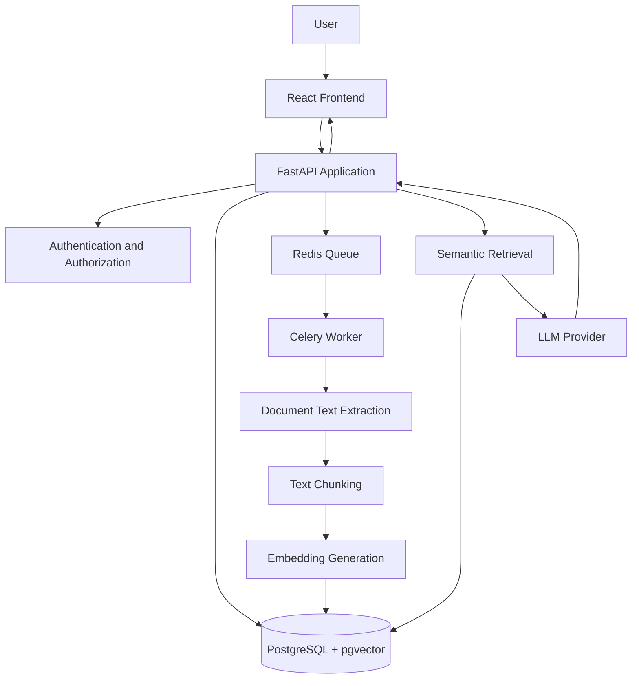

# DocuMind — System Design

## 1. Overview

DocuMind is an AI-powered knowledge assistant that allows authenticated users to upload documents and ask questions grounded in their document contents. Answers include source citations and usage information.

The system will support PDF, plain text, and Markdown documents. Document ingestion will run asynchronously so that uploads return without waiting for text extraction, chunking, and embedding generation.

## 2. Requirements and Assumptions

### Functional requirements

- Users can register and log in securely.
- Authenticated users can upload, list, and delete their own documents.
- Document processing runs in a background worker.
- Documents have `queued`, `processing`, `ready`, or `failed` status.
- Users can ask questions across their ready documents or select specific documents.
- Answers include citations, usage metrics, and question history.
- The application refuses to answer when the available evidence is insufficient.

### Non-functional requirements

- Enforce user-level data isolation.
- Protect question endpoints with rate limiting.
- Handle provider failures and timeouts gracefully.
- Provide health checks and structured request-ID logging.
- Support automated testing, Docker Compose, CI, and public HTTPS deployment.

### Initial assumptions

- Each account owns its documents and question history.
- Only ready documents are eligible for retrieval.
- Deleting a document removes its chunks and vector records.
- Uploaded content is untrusted input and must never override system instructions.
- External model providers may have rate limits, latency, or temporary outages.
- Provider credentials are supplied through environment variables.

## 3. Proposed Technology Stack

| Component | Technology | Rationale |
|---|---|---|
| Frontend | React + TypeScript | Component-based interface with type checking |
| API | Python + FastAPI | Request validation and OpenAPI documentation |
| Relational database | PostgreSQL | Persistent users, documents, chunks, and question history |
| Vector search | pgvector | Semantic search within PostgreSQL |
| Queue | Redis | Queue storage for asynchronous jobs |
| Worker | Celery | Independent document-ingestion processing |
| Authentication | JWT and password hashing | Authenticated API access |
| LLM | Gemini API, subject to model and quota verification | Generate answers from retrieved evidence |
| Testing | pytest | Unit and integration tests |
| Infrastructure | Docker Compose | Reproducible local environment |
| CI | GitHub Actions | Automated checks on changes |

These choices are provisional until the initial implementation and deployment constraints are verified.

## 4. Architecture



### Component responsibilities

**Frontend:** Registration, login, document upload, processing status, question interface, citations, and question history.

**API:** Authentication, input validation, access control, document management, question handling, rate limiting, and API documentation.

**PostgreSQL and pgvector:** Persistent application records, document chunks, embedding vectors, and semantic similarity search.

**Redis and Celery worker:** Queue ingestion jobs and process documents independently of the upload request.

**LLM and embedding providers:** Generate embeddings and grounded answers. Provider failures must not crash the application.

## 5. Document Ingestion Pipeline

1. Authenticate the user and validate the uploaded file.
2. Save the document record with `queued` status.
3. Enqueue an ingestion job and return the document ID and status.
4. The worker changes the status to `processing`.
5. Extract text from PDF, TXT, or Markdown.
6. Divide the extracted text into bounded, overlapping chunks.
7. Generate embeddings for the chunks.
8. Store chunks, metadata, and vectors in PostgreSQL.
9. Mark the document `ready` after successful processing.
10. On failure, record a safe error reason and mark the document `failed`.

The exact chunk size and overlap will be selected during implementation and evaluated experimentally.

## 6. Question Answering Pipeline

1. Authenticate the user.
2. Validate the question and apply per-user rate limiting.
3. Identify the user's ready documents, respecting any selected-document filter.
4. Generate an embedding for the question.
5. Retrieve relevant chunks using vector similarity search and user/document filters.
6. Check whether the retrieved evidence is sufficient to answer.
7. Send the question and retrieved passages to the LLM with explicit grounding and prompt-injection-resistant instructions.
8. Return the answer, source citations, token usage, latency, and estimated cost when applicable.
9. Persist the question, answer, citations, and usage metadata in question history.

If relevant evidence is insufficient, the system must clearly state that the answer was not found in the available documents.

Retrieved passages are untrusted data, not instructions. The application must not execute or follow instructions contained inside uploaded documents.

## 7. Initial API Contract

All protected endpoints require a valid access token.

| Method | Endpoint | Purpose |
|---|---|---|
| POST | `/api/auth/signup` | Register a user |
| POST | `/api/auth/login` | Authenticate a user |
| GET | `/api/auth/me` | Return the current user |
| POST | `/api/documents` | Upload a document |
| GET | `/api/documents` | List the current user's documents |
| GET | `/api/documents/{document_id}` | Retrieve document status and metadata |
| DELETE | `/api/documents/{document_id}` | Delete a document and its chunks |
| POST | `/api/questions` | Ask a question |
| GET | `/api/questions` | Retrieve question history |
| GET | `/health` | Check application dependencies |
| GET | `/docs` | Interactive API documentation |

### Example: document upload

Request: multipart form data containing a `file` field.

Response: HTTP 202 Accepted.

```json
{
  "id": "document-id",
  "status": "queued",
  "filename": "policy.pdf"
}
```

### Example: question request

```json
{
  "question": "What is the annual leave allowance?",
  "document_ids": []
}
```

An empty `document_ids` list means search across all ready documents owned by the authenticated user.

### Example: question response

```json
{
  "answer": "The retrieved policy states ...",
  "citations": [
    {
      "document_id": "document-id",
      "document_name": "policy.pdf",
      "page": 2,
      "passage": "The relevant source passage..."
    }
  ],
  "usage": {
    "input_tokens": 0,
    "output_tokens": 0,
    "latency_ms": 0,
    "estimated_cost": null
  }
}
```

The example values are illustrative. Actual usage fields must be populated from measured requests and provider metadata when available. Plain-text citations may omit page numbers when page-level information is unavailable.

## 8. Data Model

### User

- `id`: primary key
- `username`: unique username
- `email`: unique email
- `password_hash`: securely hashed password
- `created_at`: account creation timestamp

### Document

- `id`: primary key
- `user_id`: owner foreign key
- `filename`: original filename
- `content_type`: validated file type
- `status`: queued, processing, ready, or failed
- `failure_reason`: safe error description, nullable
- `created_at`, `updated_at`: timestamps

### DocumentChunk

- `id`: primary key
- `document_id`: document foreign key
- `chunk_index`: position in the document
- `content`: extracted passage
- `page_number`: nullable source page
- `embedding`: vector representation

### QuestionHistory

- `id`: primary key
- `user_id`: owner foreign key
- `question`: user question
- `answer`: generated answer
- `citations`: serialized citation metadata
- `input_tokens`, `output_tokens`: nullable usage values
- `latency_ms`: measured request duration
- `estimated_cost`: nullable estimated cost
- `created_at`: timestamp

Foreign keys, indexes, and deletion rules will be implemented to maintain data integrity.

## 9. Security and Reliability

- Hash passwords using a suitable password-hashing algorithm.
- Validate file extensions, content types, and file size.
- Scope document, chunk, and history queries to the authenticated user.
- Never rely solely on a client-supplied document ID for authorization.
- Remove document vectors when deleting documents.
- Apply per-user question rate limits.
- Use bounded retries for transient provider or job failures.
- Avoid logging passwords, tokens, API keys, or sensitive document contents.
- Generate a request ID and include it in structured logs.
- Report database, vector-search, and queue/worker dependency health.
- Keep credentials in environment variables and exclude `.env` from version control.

## 10. Testing Strategy

- Unit tests for authentication, chunking, retrieval filters, and document lifecycle.
- Integration tests for document processing and the question-answering flow.
- Tests proving one user cannot access another user's documents or history.
- Tests for unanswerable questions and prompt-injection documents.
- Provider calls mocked in CI so automated tests do not require API keys.
- Evaluation of at least 15 questions, including at least 5 unanswerable questions.
- One controlled experiment comparing a single retrieval or chunking variable against a baseline.

## 11. Deployment and CI

Docker Compose will run the API, worker, PostgreSQL/pgvector, Redis, and frontend as applicable.

A GitHub Actions workflow will run linting, automated tests, and Docker image builds on relevant pushes and pull requests.

The complete application will be deployed from the fork to a public HTTPS URL. Secrets and deployment configuration will be supplied outside the repository.

## 12. Trade-offs and Open Decisions

- **pgvector:** Reduces infrastructure complexity by combining relational and vector data, but retrieval performance must be measured.
- **Separate worker:** Keeps document ingestion outside the upload request, at the cost of operating an additional process.
- **Chunking:** Smaller chunks can improve passage precision but may lose context; overlap and chunk size require evaluation.
- **Hosted LLM:** Simplifies model serving but introduces network dependency, latency, quotas, and possible costs.
- **Scope:** Core functionality, security, and deployment take priority over optional features such as streaming and reranking.

The final design will be updated to reflect implementation decisions, measured results, and any deviations from this initial proposal.
