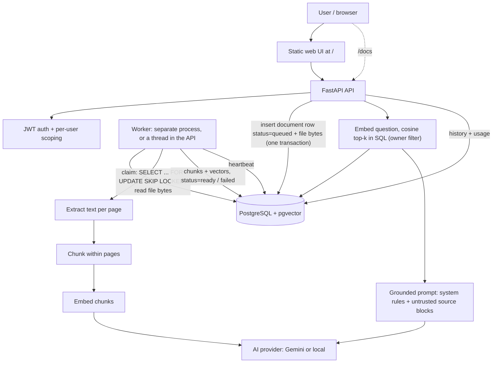

# DocuMind — System Design

## 1. Overview

DocuMind is an AI-powered knowledge assistant that allows authenticated users to upload documents and ask questions grounded in their document contents. Answers include source citations and usage information.

The system supports PDF, plain text, and Markdown documents. Document ingestion runs asynchronously so that uploads return without waiting for text extraction, chunking, and embedding generation.

## 2. Requirements and Assumptions

### Functional requirements

- Users can register and log in securely.

- Authenticated users can upload, list, and delete their own documents.

- Document processing runs in a background worker.

- Documents have `queued`, `processing`, `ready`, or `failed` status.

- Users can ask questions across their ready documents or select specific documents.

- Answers include citations, usage metrics, and question history.

- The application refuses to answer when the available evidence is insufficient.

### Non-functional requirements

- Enforce user-level data isolation.

- Protect question endpoints with rate limiting.

- Handle provider failures and timeouts gracefully.

- Provide health checks and structured request-ID logging.

- Support automated testing, Docker Compose, CI, and public HTTPS deployment.

### Initial assumptions

- Each account owns its documents and question history.

- Only ready documents are eligible for retrieval.

- Deleting a document removes its chunks and vector records.

- Uploaded content is untrusted input and must never override system instructions.

- External model providers may have rate limits, latency, or temporary outages.

- Provider credentials are supplied through environment variables.

## 3. Proposed Technology Stack

| Component | Technology | Rationale |
|---|---|---|
| Frontend | Single-page UI served by the API: plain JavaScript modules (`api.js`, `ui-logic.js`, `app.js`) and one stylesheet | **Changed from React, see section 13.** No build step, no third-party frontend dependencies, strict same-origin CSP |
| API | Python + FastAPI | Request validation and OpenAPI documentation |
| Relational database | PostgreSQL | Persistent users, documents, chunks, and question history |
| Vector search | pgvector, exact cosine distance over the user's own chunks | Semantic search within PostgreSQL. The owner filter runs before ranking, so a user always sees their best matches (section 13) |
| Queue | PostgreSQL `documents` table (`FOR UPDATE SKIP LOCKED`) | **Changed from Redis, see section 13** |
| Worker | Separate Python process (`python -m app.worker`) | **Changed from Celery, see section 13** |
| Authentication | JWT (HS256) and Argon2 password hashing (pwdlib) | Authenticated API access |
| LLM | Gemini API (`gemini-3.5-flash-lite`, embeddings `gemini-embedding-001` at 768 dims), or the offline `local` provider | Generate answers from retrieved evidence |
| Migrations | Alembic | Reproducible schema: pgvector extension and tables (0001), retry backoff column (0002), HNSW index dropped (0003), uploaded file bytes in `document_blobs` (0004) |
| Testing | pytest; ruff for linting; a Node script for UI behaviour | Unit, Postgres/pgvector integration and UI behaviour tests |
| Infrastructure | Docker Compose | Reproducible local environment |
| CI | GitHub Actions | Automated checks on changes |

Section 13 records what changed from the first version of this table and why.

## 4. Architecture



### Component responsibilities

**Web UI:** Registration, login, document upload, processing status (polled), question interface with optional document selection, citations, and question history.

**API:** Authentication, input validation, access control, document management, question handling, rate limiting, health checks, and API documentation.

**PostgreSQL and pgvector:** Persistent application records, the ingestion queue (document rows), document chunks, embedding vectors, similarity search, question history, and worker heartbeats.

**Worker:** Claims queued documents, processes them independently of the upload request, retries provider outages, and re-queues documents abandoned by a crashed worker.

**LLM and embedding providers:** Generate embeddings and grounded answers. Provider failures must not crash the application.

## 5. Document Ingestion Pipeline

1. Authenticate the user and validate the uploaded file.

2. Save the document record with `queued` status.

3. Enqueue an ingestion job and return the document ID and status.

4. The worker changes the status to `processing`.

5. Extract text from PDF, TXT, or Markdown.

6. Divide the extracted text into bounded, overlapping chunks.

7. Generate embeddings for the chunks.

8. Store chunks, metadata, and vectors in PostgreSQL.

9. Mark the document `ready` after successful processing.

10. On failure, record a safe error reason and mark the document `failed`.

Chunks are 1,000 characters with 150 characters of overlap (section 13); EVALUATION.md compares this with 400-character chunks.

## 6. Question Answering Pipeline

1. Authenticate the user.

2. Validate the question and apply per-user rate limiting.

3. Identify the user's ready documents, respecting any selected-document filter.

4. Generate an embedding for the question.

5. Retrieve relevant chunks using vector similarity search and user/document filters.

6. Check whether the retrieved evidence is sufficient to answer.

7. Send the question and retrieved passages to the LLM with explicit grounding and prompt-injection-resistant instructions.

8. Return the answer, source citations, token usage, latency, and estimated cost when applicable.

9. Persist the question, answer, citations, and usage metadata in question history.

If relevant evidence is insufficient, the system must clearly state that the answer was not found in the available documents.

Retrieved passages are untrusted data, not instructions. The application must not execute or follow instructions contained inside uploaded documents.

## 7. API Contract

All protected endpoints require a valid access token.

**As implemented. Paths changed from the first draft (`/api/...`, `/api/questions`); see section 13.**

| Method | Endpoint | Purpose |
|---|---|---|
| POST | `/auth/signup` | Register a user (201) |
| POST | `/auth/login` | Authenticate a user; returns a bearer token |
| GET | `/auth/me` | Return the current user |
| POST | `/documents` | Upload a document (202, `status: queued`) |
| GET | `/documents` | List the current user's documents |
| GET | `/documents/{document_id}` | Retrieve document status, `failure_reason` and metadata |
| DELETE | `/documents/{document_id}` | Delete a document, its chunks and embeddings (204) |
| POST | `/chat` | Ask a question (429 when rate limited, 503 if the provider fails) |
| GET | `/chat/history?limit=&offset=` | Retrieve question history |
| GET | `/health` | Database, vector store, worker and queue status (200 or 503) |
| GET | `/health/live` | Liveness only |
| GET | `/docs` | Interactive API documentation |
| GET | `/` | Web UI |

### Example: document upload

Request: multipart form data containing a `file` field.

Response: HTTP 202 Accepted.

```json
{
  "id": 7,
  "filename": "policy.pdf",
  "status": "queued",
  "failure_reason": null,
  "size_bytes": 48213,
  "page_count": null,
  "chunk_count": null,
  "created_at": "2026-10-29T14:45:12Z",
  "updated_at": "2026-10-29T14:45:12Z"
}
```

### Example: question request

```json
{
  "question": "What is the annual leave allowance?",
  "document_ids": [3, 7]
}
```

Omitting `document_ids` (or sending `null`) searches all ready documents owned by the authenticated user. A list restricts the search to those documents; if any of them is missing, not ready or owned by someone else, the API returns 404.

### Example: question response

```json
{
  "question_id": 12,
  "answer": "Full-time employees receive 24 days of paid annual leave per calendar year [S1].",
  "refused": false,
  "citations": [
    {
      "source_id": "S1",
      "document_id": 3,
      "filename": "handbook.pdf",
      "chunk_index": 4,
      "page_number": 2,
      "passage": "The relevant source passage...",
      "score": 0.71
    }
  ],
  "usage": {
    "input_tokens": 812,
    "output_tokens": 54,
    "latency_ms": 1430,
    "estimated_cost_usd": null
  }
}
```

When nothing relevant is found, the response has `"refused": true`, the answer `"I couldn't find this in your documents."` and no citations.

The example values are illustrative. Actual usage fields must be populated from measured requests and provider metadata when available. Plain-text citations may omit page numbers when page-level information is unavailable.

## 8. Data Model

**As implemented. Fields added during implementation are marked (new).**

### User

- `id`: primary key

- `email`: unique email, used as the login name (no separate username)

- `hashed_password`: Argon2 hash (pwdlib)

- `created_at`: account creation timestamp

### Document

- `id`: primary key

- `user_id`: owner foreign key

- `filename`: original filename

- `content_type`: validated file type

- `stored_path`, `size_bytes`: `db:<name>` when the file bytes are in `document_blobs` (all uploads since migration 0004), or a path on the uploads volume for older documents (new)

- `status`: queued, processing, ready, or failed (database check constraint)

- `failure_reason`: safe error description, nullable

- `attempts`: processing attempts, for bounded retries (new)

- `available_at`: earliest retry time after a provider outage; exponential backoff of 30 s, 60 s, … capped at 300 s (new, migration 0002)

- `page_count`, `chunk_count`: filled in when ready (new)

- `request_id`: upload request ID, so worker logs join the API request (new)

- `created_at`, `updated_at`: timestamps

### DocumentChunk

- `id`: primary key

- `document_id`: document foreign key

- `chunk_index`: position in the document

- `content`: extracted passage

- `page_number`: nullable source page

- `embedding`: `vector(768)`. No ANN index; migration 0003 dropped the original HNSW index (section 13)

### QuestionHistory

- `id`: primary key

- `user_id`: owner foreign key

- `question`: user question

- `answer`: generated answer

- `citations`: serialized citation metadata

- `input_tokens`, `output_tokens`: nullable usage values

- `status`: pending, answered, refused, or error (new; every attempt is stored, which also feeds the rate limiter)

- `document_ids`: the selection the question was restricted to, nullable (new)

- `latency_ms`: measured request duration

- `estimated_cost_usd`: nullable estimated cost

- `created_at`: timestamp

### WorkerHeartbeat (new)

- `worker_id`: hostname and process ID

- `last_seen`: updated every 10 seconds by a dedicated heartbeat thread, so a worker busy with a long document still counts as alive. `/health` reports the worker down after 60 seconds of silence. The same thread touches `/tmp/documind-worker-heartbeat`, which the Compose `worker` healthcheck reads.

The worker also refreshes a document's `updated_at` after each embedding batch, so stale-job recovery (after 10 minutes without progress) never re-queues a document that is still being processed.

### DocumentBlob (new, migration 0004)

- `document_id`: primary key and foreign key to `documents`
- `data`: the uploaded file (`bytea`, at most `MAX_UPLOAD_MB`)

Written in the same transaction that inserts the `queued` document, so a queued document always has its file. Storing it in Postgres makes uploads durable on hosts with ephemeral disks and readable by a worker running anywhere; older documents keep working from their files on disk.

All foreign keys use `ON DELETE CASCADE`. Document deletion also deletes chunks and the stored file explicitly in the same transaction.

## 9. Security and Reliability

- Hash passwords using a suitable password-hashing algorithm.

- Validate file extensions, content types, and file size.

- Scope document, chunk, and history queries to the authenticated user.

- Never rely solely on a client-supplied document ID for authorization.

- Remove document vectors when deleting documents.

- Apply per-user question rate limits.

- Use bounded retries for transient provider or job failures.

- Avoid logging passwords, tokens, API keys, or sensitive document contents.

- Generate a request ID and include it in structured logs.

- Report database, vector-search, and queue/worker dependency health.

- Keep credentials in environment variables and exclude `.env` from version control.

As implemented, in addition to the points above:

- Login runs an Argon2 verification even for unknown emails, so response time does not reveal which accounts exist. Signup still returns 409 for an existing email, a usability trade-off.

- Every object lookup (documents, chunks, history) includes `user_id` in the SQL `WHERE`. Another user's document ID behaves exactly like a missing one (404).

- Deleting a document also replaces its passages in saved answers with a marker.

- The UI page is served with a strict Content-Security-Policy: only its own inline script (allowed by hash), same-origin requests only, no framing. All responses carry `nosniff`, `X-Frame-Options: DENY` and `Referrer-Policy: no-referrer`.

- `/chat` ends its read-only database transaction before calling the model, so a slow LLM call can never hold a connection past Postgres's idle-transaction limit (found in the live Gemini check). On error paths, saving the history row is best-effort: if it fails, the API still reports the original provider error.

- Clients get generic error messages; logs record exception types only, never provider bodies or tracebacks. The API logs a warning at startup if `JWT_SECRET_KEY` is shorter than 32 characters.

## 10. Testing Strategy

- Unit tests for authentication, chunking, retrieval filters, and document lifecycle.

- Integration tests for document processing and the question-answering flow.

- Tests proving one user cannot access another user's documents or history.

- Tests for unanswerable questions and prompt-injection documents.

- Provider calls mocked in CI so automated tests do not require API keys.

- Evaluation of at least 15 questions, including at least 5 unanswerable questions.

- One controlled experiment comparing a single retrieval or chunking variable against a baseline.

## 11. Deployment and CI

Docker Compose runs PostgreSQL/pgvector, a one-off migration job, the API (which also serves the web UI) and the worker.

A GitHub Actions workflow is configured to run linting, automated tests, and Docker image builds on relevant pushes and pull requests. Confirm its latest run in GitHub before reporting CI as passing.

`render.yaml` is a Render Blueprint for a single free web service plus free PostgreSQL. Render's free plan has no background workers and an ephemeral filesystem, so the web service sets `RUN_EMBEDDED_WORKER=true` (the same worker loop in a background thread) and files live in `document_blobs`. Migrations run at container start (`RUN_MIGRATIONS_ON_START=true`) because free instances have no pre-deploy step. This configuration was verified locally with the production image: one container, a `postgres://` URL, migrations 0001→0004 on start, the 17-check end-to-end script, and documents surviving a destroyed and recreated container.

A public HTTPS deployment is still a remaining deliverable: it needs the owner's Render account. The deployment URL and secrets are configured in Render, never in the repository.

## 12. Trade-offs and Open Decisions

- **pgvector:** Reduces infrastructure complexity by combining relational and vector data, but retrieval performance must be measured.

- **Separate worker:** Keeps document ingestion outside the upload request, at the cost of operating an additional process.

- **Chunking:** Smaller chunks can improve passage precision but may lose context; overlap and chunk size require evaluation.

- **Hosted LLM:** Simplifies model serving but introduces network dependency, latency, quotas, and possible costs.

- **Scope:** Core functionality, security, and deployment take priority over optional features such as streaming and reranking.

This section is the original list of trade-offs. Section 13 records how each one was resolved.

## 13. Design Changes After Implementation

| Area | Initial design | Implemented | Why |
|---|---|---|---|
| Queue and worker | Redis + Celery | The `documents` table is the queue. A separate worker process claims rows with `SELECT ... FOR UPDATE SKIP LOCKED` | The upload commits the document row and enqueues it in one transaction, so a job can never be lost between "row saved" and "message sent". There is one fewer service to run, deploy and health-check. Several workers can run without taking the same job. Cost: polling (2 s) instead of push, and Postgres carries a little extra load. A real broker would be worth it at much higher volume. |
| Frontend | React + TypeScript | A single-page UI of plain JavaScript modules and CSS, served by the API at `/` | The brief asks for a usable UI, not a framework. This avoids a Node build step, an extra container and CORS, and keeps the CSP strict (no inline code). `api.js` is the only module that calls the backend; `ui-logic.js` holds pure, unit-tested rules (validation, status and health mapping); `app.js` renders with `textContent` only, so document text cannot inject HTML. The health pill reflects the real `/health` response, never just "page loaded". |
| API paths | `/api/...`, `/api/questions` | `/auth`, `/documents`, `/chat`, `/chat/history` | Kept the paths the first implementation already used and tested, rather than renaming everything late. |
| Upload status code | 202 | 202 | Unchanged. An earlier code iteration returned 201 and ran ingestion inside the API process (FastAPI `BackgroundTasks`). That was replaced, because the brief requires a separate worker. |
| AI provider | Gemini only | `AI_PROVIDER=gemini` (default) or `local` | `local` uses hashed bag-of-words embeddings and an extractive answerer. It makes no network calls, so tests, CI, offline development and the evaluation baseline run without API keys or cost. It is lexical, not semantic, and is not meant for production answers. |
| Rate limiting | Per-user limit (store not decided) | Count of the user's `question_history` rows in the last 60 s | It survives restarts and works across API replicas without Redis. Every attempt is counted, including failed ones. Cost: one indexed `COUNT` per question, and concurrent requests can exceed the limit by a small amount. |
| Health | Database, vector store, queue | Also worker liveness, using heartbeats in Postgres | With no broker, a heartbeat table is the simplest way to show that the worker is actually running. |
| File storage | Shared uploads volume | File bytes in Postgres (`document_blobs`, migration 0004) | Hosted services get their own, often ephemeral, disk, so a shared volume does not exist there. Files up to 10 MB in Postgres are durable, backed up with the data, and need no extra service. Object storage would suit much larger files. |
| Worker hosting | Always a separate process | Separate `worker` service (Compose), or `RUN_EMBEDDED_WORKER=true` in the API process | Free hosting tiers do not run background workers. The embedded mode runs the same loop, so behaviour and tests are shared; for scale, use the separate process. |

### Retrieval and grounding decisions

- **Chunking:** windows of 1,000 characters with 150 characters of overlap. Cuts are moved to the nearest whitespace, and a chunk never crosses a PDF page, so every citation has exactly one page number. The evaluation compares this with 400-character chunks; see `EVALUATION.md`. Treat the results as limited to the evaluation runs recorded there, not as proof of production performance.

- **Embeddings:** `gemini-embedding-001` truncated to 768 dimensions. Retrieval and indexing use the RETRIEVAL_QUERY and RETRIEVAL_DOCUMENT task types.

- **Retrieval:** a `MATERIALIZED` CTE first selects the user's `ready` chunks, which are then ranked by exact cosine distance; top-k is 5. The first version used an HNSW index. During the final audit, a test showed that when the planner picks the index, Postgres takes ~40 nearest neighbours **across all users** and only then filters by owner, so a user could get zero results despite having a matching chunk. Even pgvector 0.8's iterative scan did not recover it in that test. Exact per-user ranking is always correct. The query takes the top k from the materialised distances first, then loads only those k rows by primary key. Measured locally with 50,000 other users' chunks in the table: about 12 ms of database time for a user with 1,000 chunks and about 45 ms for one with 10,000. Distances are computed only for the user's own chunks. However, Postgres may still find those rows with a full sequential scan of `document_chunks` when the user owns a large share of them, so the cost is not strictly independent of table size. At much larger scale I would partition by tenant or use per-tenant indexes, rather than filtering after a global ANN scan. The index was dropped in migration 0003, and `test_hnsw_retrieval_finds_a_users_chunks_behind_many_closer_foreign_chunks` guards the behaviour. Results are then filtered by a maximum distance: 0.55 for Gemini and 0.95 for local. The Gemini threshold still needs broader live evaluation because provider calls have been intermittent. This gate only skips generation for clearly unrelated text. The answer step decides refusals, which is why the local value was loosened from 0.90 after it refused an answerable hotel question (EVALUATION.md, run 1). Both values can be changed with `RAG_TOP_K` and `RAG_MAX_COSINE_DISTANCE`. If no chunk passes the threshold, the API refuses without calling the LLM.

- **Refusal:** one fixed sentence, "I couldn't find this in your documents.", is used both by the retrieval gate and by the model's instructions. A model refusal is normalised to that sentence and its citations are dropped.

- **Citations:** passages are labelled `[S1]`, `[S2]` and so on, and only the sources the answer actually cites are returned. Single and grouped forms (`[S3]`, `[S1, S3]`) are both recognised, because Gemini uses both. If the model cites none, every retrieved source is returned.

### Prompt-injection defences (layered)

1. Rules are sent as the system instruction, separate from the user turn that holds the sources and the question.

2. Each passage is wrapped in a `<source>` block. `<source` and `</source` inside document text are escaped, so a document cannot close its own block or pretend to be a new one.

3. The rules state that source text is untrusted data and must never be followed.

4. Retrieved passages are scanned for common injection phrases and matches are logged. They are not removed, so a user can still ask what a document says.

5. Output guard: if an answer contains the system-instruction canary, or matches injection patterns itself, it is replaced with the refusal. The evaluation found the need for the second check (run 0, question i01).

6. Credentials are redacted in passages, answers, citations and stored questions.

### Known trade-offs and limits

- Uploads are stored on a local volume shared by the API and the worker. Running several hosts would need object storage (for example S3).

- The pattern-based injection detection is a heuristic. It reduces risk but does not eliminate it, and the main protection remains the separation of system rules from data.

- Token counts come from provider usage metadata. Cost stays `null` unless prices are set with `GEMINI_INPUT_USD_PER_MTOK` and `GEMINI_OUTPUT_USD_PER_MTOK`, rather than shipping prices that may be outdated.

- **Generation model:** `gemini-3.5-flash-lite` (overridable with `GEMINI_GENERATION_MODEL`). It replaced `gemini-3.8-flash` after the project hit that model's free-tier limit (about 20 requests per day). Google's docs list 3.5 Flash-Lite as stable, free-tier, and accepting `thinking_level=LOW`. `gemini-3.1-flash-lite` was not chosen because its LOW support is undocumented. The SDK options are unit-tested with mocks. Manual live Gemini checks have also been attempted, but results have been intermittent and timeouts mean the full scripted live evaluation remains incomplete. With a 30 s timeout, 7 of 13 logged requests answered (2.5–26.9 s) and 6 hit the deadline, while using only 18–131 output tokens; the request itself was well-formed, so the latency appears to be on the provider side (FINAL_AUDIT row 22). `GEMINI_THINKING_LEVEL` (default `LOW`) makes the thinking level configurable for live experiments; `MINIMAL` is supported but not shown to help. `AI_PROVIDER` and `GEMINI_THINKING_LEVEL` are validated at API and worker startup, so a typo fails fast instead of silently using Gemini.

- **Provider rate limits:** an HTTP 429 (per-minute limit or daily quota) becomes `AIProviderRateLimited`. The SDK retries only 408, 500, 502 and 503, once. It never retries 429 (an immediate retry cannot succeed and spends another request) or 504: the SDK sends our timeout (`GEMINI_TIMEOUT_MS`, 15 s by default) as `X-Server-Timeout`, so a 504 means the model did not finish within it, and in both live checks the retry timed out again. `/chat` returns 503 with a usage-limit message and `Retry-After`; ingestion retries later with backoff and then fails with a clear reason. Free-tier limits are per Google Cloud project and reset at midnight Pacific time.
