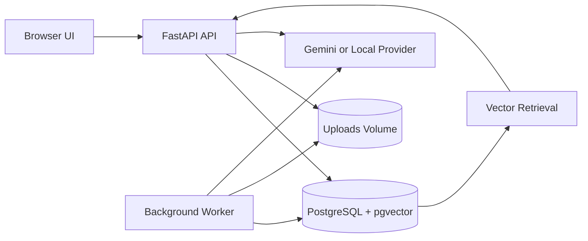

# DocuMind — AI Knowledge Assistant

> An AI-powered knowledge assistant that lets users upload documents and ask questions in natural language. Answers are grounded in uploaded content and include source citations.

## Project Links

| Resource | Link |
|---|---|
| **Live Application** | [https://documind-1m6x.onrender.com](https://documind-1m6x.onrender.com) |
| **Health Check** | [Application Health](https://documind-1m6x.onrender.com/health) |
| **API Documentation** | [Interactive API Docs](https://documind-1m6x.onrender.com/docs) |
| **Demo Video** | [Watch DocuMind Demo](https://drive.google.com/file/d/1lZeC6rXnXwva5-NytKbu076ncotWsdxr/view?usp=sharing) |
| **GitHub Repository** | [Software-Engineering-Assessment](https://github.com/sarthakaleriyaa/Software-Engineering-Assessment) |
| **Implementation Branch** | [feature/project-architecture](https://github.com/sarthakaleriyaa/Software-Engineering-Assessment/tree/feature/project-architecture) |
| **Commit History** | [View Commits](https://github.com/sarthakaleriyaa/Software-Engineering-Assessment/commits/feature/project-architecture/) |
| **Resume** | [RESUME.pdf](RESUME.pdf) |

## Implementation and Deployment Details

| Item | Details |
|---|---|
| Repository owner | `sarthakaleriyaa` |
| Default branch | `main` |
| Implementation branch | `feature/project-architecture` |
| Deployment branch | `feature/project-architecture` |
| Latest verified commit | `5814dca` |
| Total commits on implementation branch | 17 |
| Hosting platform | Render |
| Deployment service | `documind` |
| Database | Render PostgreSQL |
| CI workflow | GitHub Actions |

The implementation branch contains the project implementation and is deployed to the public Render URL.

## CI / GitHub Actions

The project uses GitHub Actions to run automated checks when changes are pushed.

**Latest verified workflow run:**

- Workflow: `sarthakaleriyaa-ci`
- Run number: `#4`
- Run ID: `41013752272`
- Commit: `5814dca`
- Branch: `feature/project-architecture`
- Trigger: Push
- Status: **Success**
- Duration: 53 seconds

| Job | Result |
|---|---|
| `lint-and-test` | Passed |
| `docker` | Passed |

[View Successful GitHub Actions Run](https://github.com/sarthakaleriyaa/Software-Engineering-Assessment/actions/runs/41013752272)

## Project Status

- Core application implemented.
- Docker-based local setup implemented.
- Automated CI workflow successfully executed on GitHub.
- Public HTTPS deployment completed.
- PDF and TXT upload tested on the deployed application.
- Question-answering flow tested on the deployed application.
- Demo video recorded and shared.

**Remaining submission items:**

- GitHub issues and pull requests.
- `v1.0.0` GitHub release and tag.
- Full scripted evaluation using the live Gemini provider.
- Additional deployment screenshots.

## What It Does

DocuMind is an AI-powered knowledge assistant that allows authenticated users to upload PDF, plain-text and Markdown documents and ask questions in natural language.

Answers are grounded in uploaded documents, include source citations and page references where available, and clearly state:

> "I couldn't find this in your documents."

### Key Features

- **Authentication:** User registration and login with Argon2 password hashing and JWT bearer tokens.
- **Document Upload:** Upload PDF, TXT and Markdown files.
- **Background Processing:** A separate worker processes documents asynchronously.
- **Processing Status:** Documents move through `queued`, `processing`, `ready` or `failed` states.
- **Document Selection:** Ask questions across all uploaded documents or select specific documents.
- **Retrieval-Augmented Generation (RAG):** Retrieve relevant document passages using vector similarity search.
- **Source Citations:** Answers include source document, passage and page information where available.
- **Usage Information:** Track token usage, latency and estimated cost.
- **Question History:** Questions and answers are stored for later access.
- **User Isolation:** Users can access only their own documents, chunks and question history.
- **Rate Limiting:** Per-user limits protect the question endpoint.
- **Health Monitoring:** `/health` reports application dependencies and worker status.
- **API Documentation:** Interactive OpenAPI documentation is available at `/docs`.

## Web Interface

The web interface is served by FastAPI at `/`. It is a responsive single-page application built using plain JavaScript modules and CSS, with no frontend build step or third-party frontend dependencies.

The interface includes:

1. Sign in and account registration with validation.
2. Live system status based on the `/health` endpoint.
3. Knowledge base with drag-and-drop document uploads.
4. Upload progress and document processing status.
5. Document selection, refresh and deletion.
6. Grounded Q&A console with cited answers.
7. Clear outcomes for answers, missing information and errors.
8. Question history with usage information.

## Architecture



The application consists of four Docker Compose services:

- `db` — PostgreSQL 17 with pgvector.
- `migrate` — Alembic database migrations.
- `api` — FastAPI backend and web interface.
- `worker` — Background document-processing worker.

The `documents` table also acts as the background job queue. PostgreSQL row locking with `FOR UPDATE SKIP LOCKED` is used to safely claim jobs without requiring a separate message broker.

See [DESIGN.md](DESIGN.md) for the complete architecture, API contract, data model and technical trade-offs.

## How a Question Is Answered

1. The client sends `POST /chat` with a bearer token.
2. The API verifies the JWT and loads the authenticated user.
3. The per-user rate limit is checked. Ten or more questions in the last 60 seconds result in HTTP 429 with `Retry-After`.
4. The question is saved in history with a pending status.
5. If specific document IDs are supplied, the API verifies that they belong to the user and are ready.
6. The question is embedded using the configured 768-dimensional retrieval embedding.
7. Relevant chunks are retrieved from the user's ready documents using cosine similarity.
8. The top five relevant chunks are checked against a maximum-distance threshold.
9. If no chunk passes the threshold, the system returns the fixed refusal without calling the LLM.
10. Otherwise, retrieved passages are passed to the LLM as untrusted source content.
11. The LLM generates a grounded answer with source references such as `[S1]` or `[S1, S3]`.
12. The API returns the answer, citations, usage information, latency and estimated cost, and updates question history.

Provider failures are handled with appropriate error responses. Provider error bodies and credentials are not exposed in API responses or logs.

## Technology Stack

| Component | Technology |
|---|---|
| Backend API | Python, FastAPI |
| Database | PostgreSQL 17 |
| Vector Search | pgvector |
| ORM | SQLAlchemy |
| Migrations | Alembic |
| Authentication | JWT, Argon2 |
| LLM Provider | Google Gemini |
| Generation Model | `gemini-3.5-flash-lite` |
| Embedding Model | `gemini-embedding-001` |
| Embedding Dimensions | 768 |
| PDF Extraction | pypdf |
| Background Processing | Python worker with PostgreSQL queue |
| Frontend | HTML, CSS, JavaScript |
| Containerization | Docker, Docker Compose |
| Testing | pytest |
| Linting | Ruff |
| CI/CD | GitHub Actions |
| Deployment | Render |

An offline `local` provider is also available for tests and evaluation without external API calls.

## Local Setup

### Requirements

- Python 3.12+
- Docker Desktop or Docker Engine
- Docker Compose v2
- Git

### 1. Clone the repository

```bash
git clone https://github.com/sarthakaleriyaa/Software-Engineering-Assessment.git
cd Software-Engineering-Assessment/submissions/sarthakaleriyaa
```

### 2. Create environment configuration

```bash
cp .env.example .env
```

On Windows PowerShell:

```powershell
Copy-Item .env.example .env
```

### 3. Configure environment variables

Edit `.env` and configure:

- `POSTGRES_PASSWORD`
- `JWT_SECRET_KEY`
- `AI_PROVIDER`
- `GEMINI_API_KEY` (only when using Gemini)

Generate a secure JWT secret:

```bash
python -c "import secrets; print(secrets.token_urlsafe(48))"
```

For offline development and testing, configure:

```env
AI_PROVIDER=local
```

For Gemini-powered answers, configure:

```env
AI_PROVIDER=gemini
GEMINI_API_KEY=your_google_ai_studio_key
```

Never commit API keys or private credentials to GitHub.

### 4. Start the application

```bash
docker compose up --build
```

### 5. Access the application

| Service | URL |
|---|---|
| Web Interface | http://localhost:8000/ |
| API Documentation | http://localhost:8000/docs |
| Health Endpoint | http://localhost:8000/health |

The migration service runs first and exits after applying database migrations. The API and background worker then start.

## Running Without Docker

Python 3.12+ is required.

Start the database:

```bash
docker compose up -d db
```

Create and activate a virtual environment:

```bash
cd backend
python -m venv .venv
```

Linux/macOS/WSL:

```bash
source .venv/bin/activate
```

Windows PowerShell:

```powershell
.venv\Scripts\Activate.ps1
```

Install dependencies:

```bash
pip install -r requirements-dev.txt
```

Apply migrations:

```bash
alembic upgrade head
```

Start the API:

```bash
uvicorn app.main:app --reload
```

Start the worker in another terminal:

```bash
python -m app.worker
```

## Tests and Linting

Run tests from the `backend/` directory:

```bash
python -m pytest tests -q
```

Run lint checks:

```bash
ruff check .
ruff check ../evaluation --config ruff.toml
```

The PostgreSQL and pgvector integration tests require `TEST_DATABASE_URL` to point to a disposable test database. These tests recreate their schema, so never point them at a database containing data you need to preserve.

## Evaluation Summary

The evaluation dataset contains 24 questions across five original documents:

- 16 answerable questions.
- 8 unanswerable questions, including two prompt-injection attacks.

The reported baseline metrics below come from the offline `local` provider.

| Metric | Baseline |
|---|---:|
| Retrieval hit rate | 1.000 |
| Answer correctness | 0.938 |
| Correct refusal rate | 0.875 |
| Injection payload leaks | 0 / 24 |

An experiment with 400-character chunks showed no measurable improvement over the 1,000-character default.

A few manual Gemini checks have been performed, but the complete scripted Gemini evaluation has not been completed. These local evaluation metrics should not be interpreted as live Gemini evaluation results.

See [EVALUATION.md](EVALUATION.md) for methodology, experiments and detailed results.

## Deployment

The application is deployed on Render.

- **Live URL:** https://documind-1m6x.onrender.com
- **Health endpoint:** https://documind-1m6x.onrender.com/health
- **API documentation:** https://documind-1m6x.onrender.com/docs
- **Deployment branch:** `feature/project-architecture`

The deployment uses a Render web service and managed PostgreSQL database.

### Deployment Notes

The current deployment is intended for assessment demonstration and testing.

The Render free tier may spin down the web service after inactivity, which can result in a cold start when accessing the application again. Free database availability and retention are also subject to Render's current free-tier limits.

For production use, configure suitable persistent storage, backups, monitoring and an appropriate paid hosting plan.

## Current Feature Status

| Requirement | Status |
|---|---|
| User authentication, password hashing and JWT | Completed |
| Per-user data isolation | Implemented and tested |
| PDF, TXT and Markdown upload | Implemented |
| Background document processing | Implemented |
| Document processing statuses | Implemented |
| Document selection and retrieval | Implemented |
| RAG-based question answering | Implemented |
| Source citations | Implemented |
| Question history and usage information | Implemented |
| Rate limiting and provider failure handling | Implemented |
| Health checks and structured logging | Implemented |
| Responsive web interface | Implemented |
| OpenAPI documentation | Implemented |
| Docker Compose setup | Implemented |
| GitHub Actions CI workflow | Successfully executed |
| Public HTTPS deployment | Completed |
| Demo video | Recorded and shared |
| GitHub issues | Not yet created |
| Pull requests | Not yet created |
| `v1.0.0` release and tag | Not yet created |
| Full scripted Gemini evaluation | Pending |

## Known Limitations

- **OCR:** Scanned or image-only PDFs are not supported. Documents need extractable text.
- **Document storage:** The current architecture uses a shared uploads volume. For larger deployments, object storage such as S3 or GCS would be preferable.
- **Background processing:** The worker polls PostgreSQL periodically. A dedicated message broker or notification mechanism may be preferable at higher scale.
- **Rate limiting:** The current implementation uses database-backed question counts. A distributed token-bucket implementation could be more suitable under heavy concurrency.
- **Retrieval:** Current retrieval uses vector similarity with a fixed threshold. Hybrid BM25 and vector search with a reranker could improve retrieval quality.
- **Prompt injection:** Multiple defensive layers are implemented, but prompt-injection detection remains heuristic and cannot guarantee detection of every possible attack.
- **Conversation memory:** Multi-turn conversational memory and streaming responses are not currently implemented.
- **PDF extraction:** Table-aware extraction is not currently supported.

## Documentation

- [DESIGN.md](DESIGN.md) — System architecture, requirements, API contract and technical decisions.
- [EVALUATION.md](EVALUATION.md) — Evaluation dataset, methodology, results and experiments.
- [AI_USAGE.md](AI_USAGE.md) — AI tools and usage disclosure.
- [FINAL_AUDIT.md](FINAL_AUDIT.md) — Requirement audit and implementation review.

---

**Project:** DocuMind — AI Knowledge Assistant  
**Implementation branch:** `feature/project-architecture`  
**Latest verified commit:** `5814dca`  
**Live deployment:** [documind-1m6x.onrender.com](https://documind-1m6x.onrender.com)
